<div align="center">
<pre>
                  █████████                                                                      
                 ███░░░░░███                                                                     
                ░███    ░░░  ████████   ██████    ██████  █████ ████   ████████╗██╗  ██╗████████╗
                ░░█████████ ░░███░░███ ░░░░░███  ███░░███░░███ ░███    ╚══██╔══╝╚██╗██╔╝╚══██╔══╝
                 ░░░░░░░░███ ░███ ░███  ███████ ░███ ░░░  ░███ ░███       ██║    ╚███╔╝    ██║   
                 ███    ░███ ░███ ░███ ███░░███ ░███  ███ ░███ ░███       ██║    ██╔██╗    ██║   
                ░░█████████  ░███████ ░░████████░░██████  ░░███████  ██╗  ██║   ██╔╝ ██╗   ██║   
                 ░░░░░░░░░   ░███░░░   ░░░░░░░░  ░░░░░░    ░░░░░███  ╚═╝  ╚═╝   ╚═╝  ╚═╝   ╚═╝   
                             ░███                          ███ ░███                              
                             █████                        ░░██████                               
                            ░░░░░                          ░░░░░░                                
</pre>
</div>

<p align="center">
  
</p>

<div align="center">
  
```
[+]   spacy:~/uinfo   ☰ 🗕 🗙
```

</div>

```
╔ Welcome!
║ / —Impossibol04 ✗ Spacysteme
╚══🜲› Silence speaks louder under the cherry blossoms ❀
```

<div align="center">

</div>

 **Discord bot developer · OSINT learner**

French indie developer building weird and fun things with code.
Mostly working on **Discord bots and random experiments for fun**.

---

##  Currently hacking on

* Discord bot experiments
* Learning OSINT
* Breaking my Arch install (again) 

---

##  Stack

<div align="center">


</div>
  
<div align="center">

</div>

---

##  Friends' projects

 **[KiwiSocial](https://kiwisocial.eu)** — *Today is a new day, join KiwiSocial.*

---

##  My Build

<div align="center">


</div>


##  Contact

<div align="center">

[](https://discord.com/users/882726168736976896)

<a href="https://guns.lol/spxcy"></a>

</div>

<p align="center">
  
</p>


